# Arquitectura y flujo

Cómo funciona el sistema por dentro. Para *qué* hace y *por qué*, ver `FUNCIONAL.md`.

---

## 1. Visión general

Tres modelos de IA que **nunca se ejecutan a la vez**. La RTX 3070 tiene 8 GB y el
escritorio de Windows ya ocupa ~2 GB, así que el pipeline los encadena y descarga cada uno
antes de cargar el siguiente.

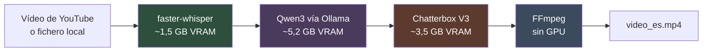

Pico real medido: **7,3 GB de 8 GB**, durante la traducción. Si los tres modelos se
cargaran a la vez no cabrían.

---

## 2. Las 7 etapas

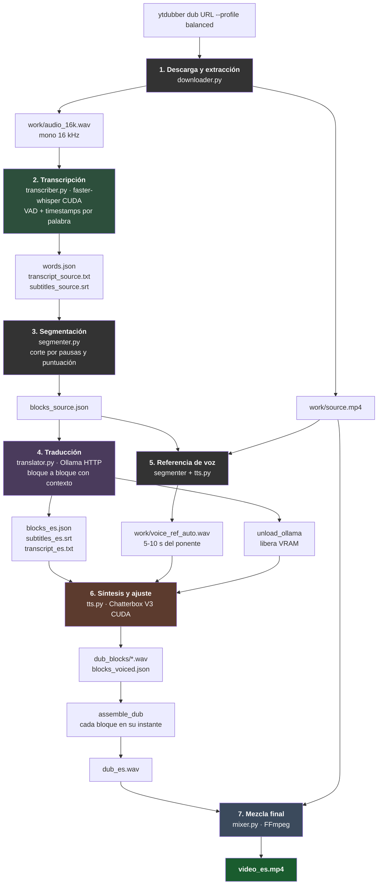

---

## 3. Segmentación: dónde cortar

Es la etapa más delicada. Un corte malo arrastra errores a la traducción y al doblaje.

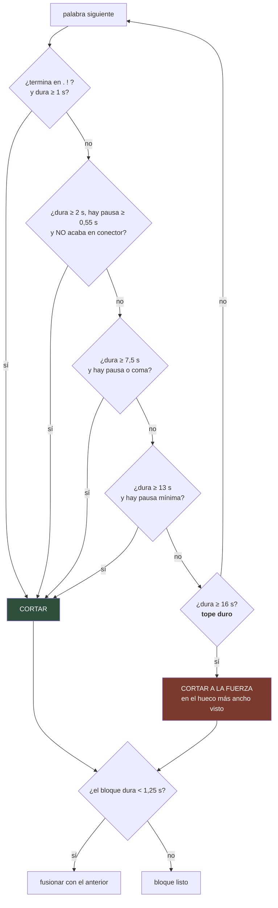

**El tope duro existe por una razón concreta.** Todas las reglas preferentes exigen
puntuación *o* una pausa. Hay transcripciones que no tienen ninguna de las dos —habla
continua sin puntuar— y entonces el guard de conectores puede vetar *todos* los cortes. Sin
tope, un bloque creció hasta 246 segundos y 4087 caracteres, desbordó el contexto del TTS y
mató el proceso con un *device-side assert* de CUDA.

**Conectores**: no se corta justo después de `and, or, but, so, when, that, because, the,
a, to, of, in, on...` salvo que la frase termine en punto. Evita el clásico *"...y"* ⏎
*"...entonces"*.

---

## 4. Encaje temporal: el corazón del doblaje

El español ocupa ~11 % más que el inglés y Chatterbox habla a ~111 palabras/minuto. Casi
siempre sobra audio. Estas son las reglas, por orden:

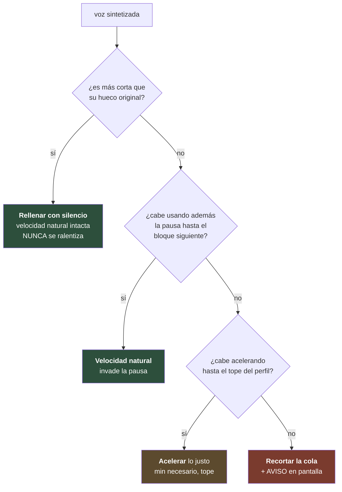

Tres garantías que el código cumple siempre:

1. **Nunca se ralentiza** una frase corta para rellenar su hueco. Se completa con silencio.
2. **La aceleración tiene tope** por perfil, y se aplica `min(necesario, tope)` — los
   bloques que ya caben no se tocan.
3. **Si hay que recortar, se avisa** con el número de bloque y los segundos que sobran.

### Ventana disponible

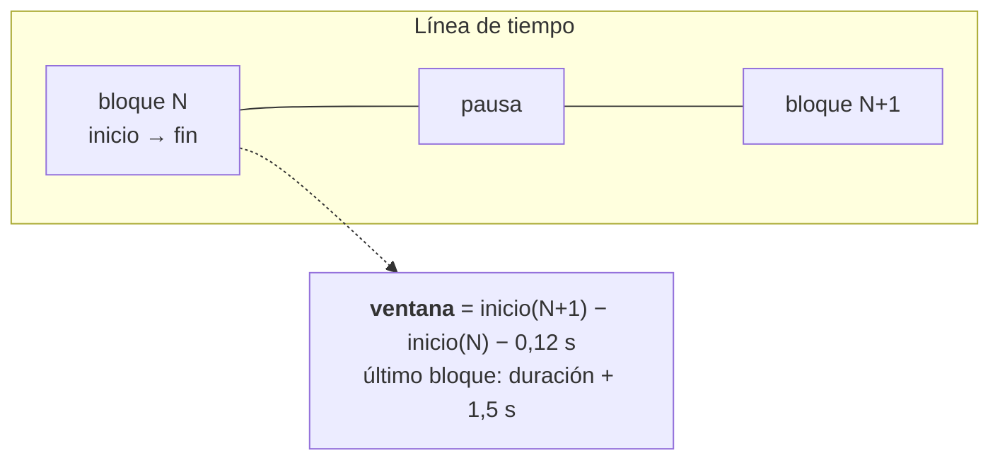

El margen de 0,12 s evita que una frase pise el arranque de la siguiente.

---

## 5. Traducción

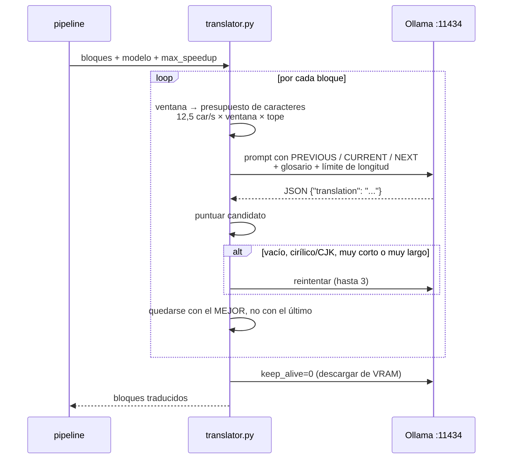

- **Contexto sin contaminación**: al modelo se le dan el bloque anterior y el siguiente
  como contexto, con instrucción explícita de traducir *solo* el actual.
- **Presupuesto de longitud**: se le pide una traducción que quepa en el tiempo disponible,
  con un suelo del 60 % de la longitud original para que no omita contenido.
- **Puntuación de candidatos**: la completitud satura al llegar a la longitud del original
  —más largo no es más completo— y se penaliza el exceso. Alfabeto extraño resta 2 puntos.
- **Respaldo**: si los 3 intentos fallan, se conserva el texto original y se avisa.

---

## 5.b Elección de la referencia de voz

**La decisión más influyente de todo el pipeline**, y la menos obvia.

Chatterbox no solo clona el timbre: **clona el ritmo** del clip que se le da como
referencia, de forma casi proporcional. Si la referencia es un pasaje donde el ponente va
despacio, *todas* las frases del doblaje saldrán lentas, no cabrán en su hueco y se
recortarán.

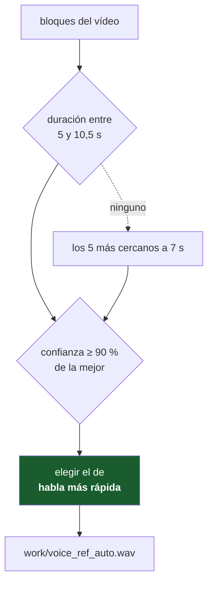

Medido sobre el mismo vídeo, aislando esta única variable:

| referencia | ritmo del doblaje | voz recortada |
|---|---|---|
| 8,74 car/s | 9,93 car/s | 693 s |
| 19,74 car/s | 14,89 car/s | 57 s |

**92 % menos de voz perdida, a coste cero.** El filtro de confianza sigue mandando primero:
un fragmento rápido que el reconocimiento apenas entendió es una mala muestra de voz.

Si das tu propia referencia con `--voice-ref`, esta selección no se aplica. Elige un clip
donde la persona hable a buen ritmo, no uno donde haga pausas.

---

## 6. Síntesis de voz

Chatterbox genera **tokens de voz a 25/segundo**. La duración es literalmente
`nº_tokens / 25`: no hay parámetro de velocidad, la duración es un resultado del muestreo.
Como muestrea con `temperature=0.8`, cada toma de la misma frase sale distinta —medido,
entre un 18 % y un 30 % de dispersión.

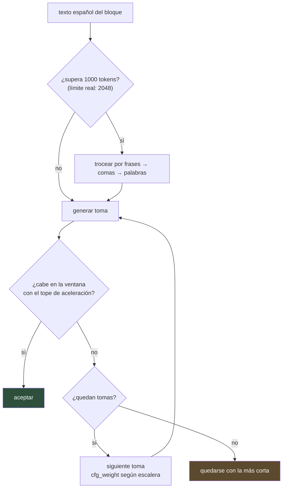

**Escalera de `cfg_weight`** (`balanced`: `0.0 → 0.0 → 0.3`): las primeras tomas conservan
el `0.0` que impide que la referencia inglesa arrastre su acento al español. Solo cuando un
bloque va camino de que le corten el final se sube, porque un poco de acento es mejor que
perder palabras. El valor realmente usado queda anotado en `blocks_voiced.json`.

El troceo es una red de seguridad: con la segmentación correcta no llega a dispararse
nunca, pero evita que un caso patológico mate el proceso.

---

## 7. Mezcla final

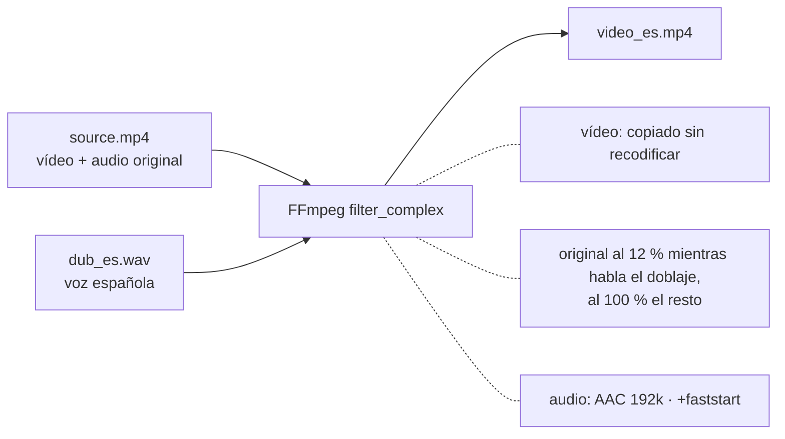

**La música y los efectos se conservan.** No hay separación de fuentes: el audio original
se atenúa (*ducking*) solo durante las ventanas de voz doblada y vuelve a volumen completo
en cuanto callan. El vídeo se copia tal cual, sin pérdida ni tiempo de recodificación.

---

## 8. Panel de control

El panel **no reimplementa nada**: ejecuta la misma CLI como subproceso y lee su salida.

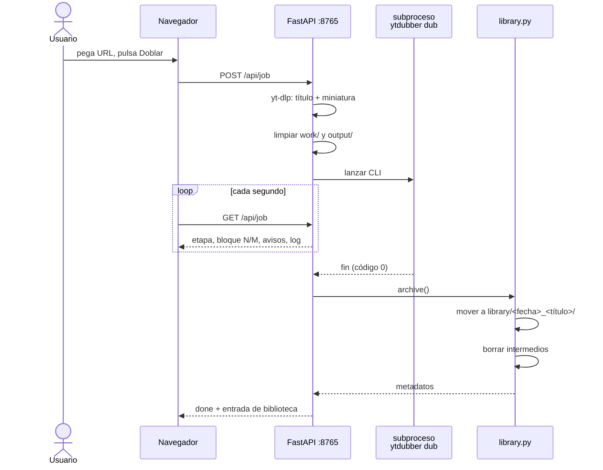

**Un trabajo cada vez.** El pipeline usa `work/` y `output/` compartidos; dos en paralelo
se pisarían. Un segundo intento devuelve `409` con la explicación.

### Estados

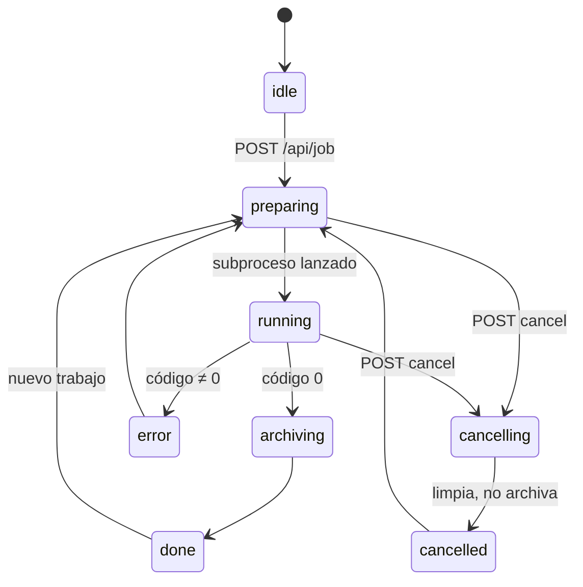

---

## 9. Mapa de módulos

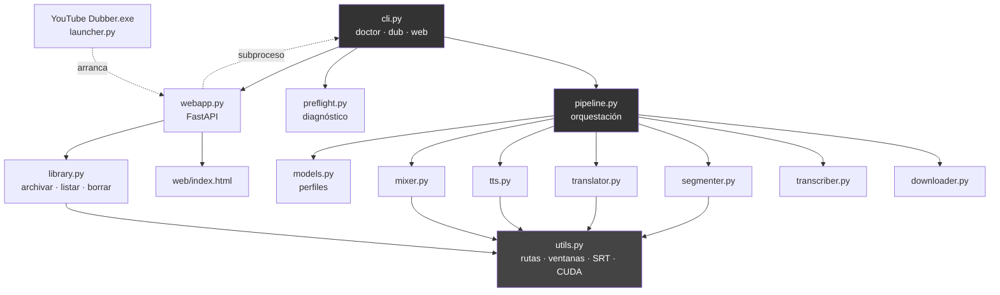

| Módulo | Responsabilidad |
|---|---|
| `cli.py` | Punto de entrada. Subcomandos y argumentos |
| `pipeline.py` | Orquesta las 7 etapas. No contiene lógica de negocio |
| `downloader.py` | yt-dlp + extracción de audio. Purga descargas previas |
| `transcriber.py` | faster-whisper con VAD y timestamps por palabra |
| `segmenter.py` | Corte en bloques y elección de la referencia de voz |
| `translator.py` | Ollama, presupuesto de longitud, reintentos puntuados |
| `tts.py` | Chatterbox, selección de tomas, encaje temporal, ensamblado |
| `mixer.py` | Ducking del original y multiplexado final |
| `models.py` | Perfiles `fast` / `balanced` / `quality` |
| `utils.py` | Rutas, geometría de ventanas, SRT, DLL de CUDA |
| `preflight.py` | `ytdubber doctor` |
| `webapp.py` | API del panel y runner de trabajos |
| `library.py` | Biblioteca y limpieza de residuos |

---

## 10. Dependencias externas

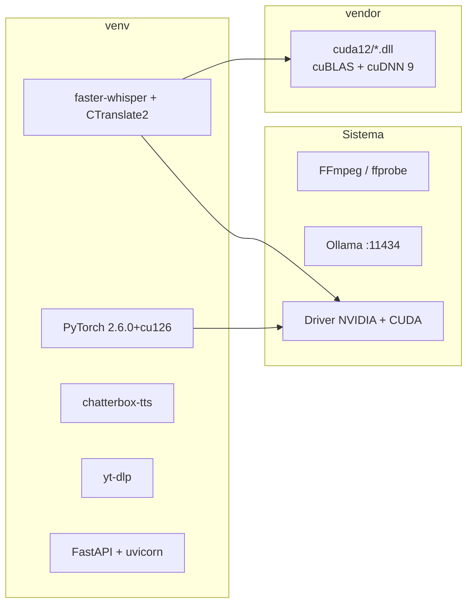

**Sobre `vendor/cuda12/`**: CTranslate2 necesita `cublas64_12.dll` y cuDNN 9 en Windows.
El proyecto los lleva en local y los registra con `os.add_dll_directory()` antes de
importar. Así se evita tocar `System32`. Es la causa del clásico
`cublas64_12.dll is not found` si esa carpeta está vacía.
